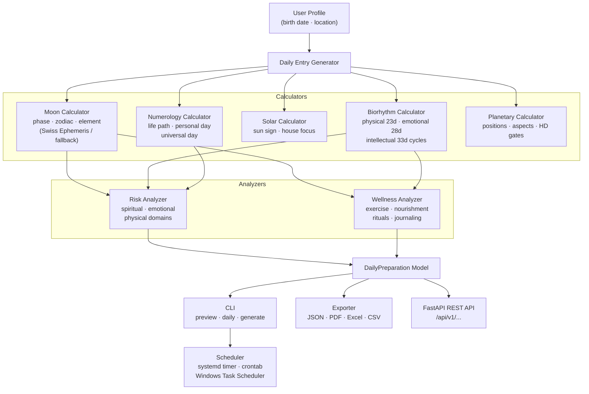

# SKSkyforge

[](https://pypi.org/project/skskyforge/)
[](https://www.npmjs.com/package/@smilintux/skskyforge)
[](https://www.gnu.org/licenses/agpl-3.0)
[](https://pypi.org/project/skskyforge/)

**Sovereign Alignment Calendar System** — forge your path through the cosmos.

SKSkyforge generates personalized daily preparation guides by integrating moon phases, biorhythm cycles, numerology, solar position, planetary aspects, Human Design gates, and wellness recommendations into a single coherent daily report. Built for the sovereign individual who wants a structured, data-driven morning briefing anchored in both natural cycles and esoteric tradition, it runs equally well as an interactive CLI, a scheduled crontab/systemd timer, or a FastAPI REST service. Profiles store birth data once; every subsequent report is computed from that foundation without repeated input.

---

## Install

### Python (pip)

```bash
pip install skskyforge
```

With the optional web/API server:

```bash
pip install "skskyforge[web]"
```

### npm

```bash
npm install -g @smilintux/skskyforge
```

The npm package exposes the `skskyforge-js` CLI shim for environments where Node.js tooling manages the PATH.

---

## Architecture



---

## Features

- **Moon phase engine** — New Moon through Waning Crescent with illumination percentage, zodiac sign, element (Fire/Earth/Air/Water), modality, and energy theme for all 12 signs; uses Swiss Ephemeris (`pyswisseph`) when installed, otherwise falls back to a built-in simplified formula accurate to within ~1°
- **Biorhythm cycles** — standard sinusoidal model for physical (23-day), emotional (28-day), and intellectual (33-day) cycles; detects critical crossover days and recommends peak activity windows
- **Solar position** — ecliptic longitude via Swiss Ephemeris or simplified algorithm; derives sun sign and natal house focus (1–12) from the angular distance between transit and birth Sun
- **Numerology** — life path reduction, personal year/month/day, and universal day computed from birth date; each number maps to an archetypal theme
- **Planetary positions and HD gates** — ecliptic longitudes for all major planets via Swiss Ephemeris mapped to Human Design gates (1–64) and major aspects (conjunction, sextile, square, trine, opposition)
- **Multi-domain risk analysis** — weighted composite score across spiritual, emotional, and physical domains derived from Moon void-of-course status, biorhythm critical days, low-cycle values, and challenging numerology; outputs warnings, protective practices, and grounding techniques scaled to risk level (Low / Moderate / Elevated / High)
- **Wellness recommendations** — exercise type and intensity keyed to physical biorhythm level and lunar element; element-aligned nourishment (meal suggestions, foods to emphasize/minimize, hydration); morning ritual with breathwork and movement; element-based meditation technique and mantra; evening wind-down schedule; journaling prompts per zodiac sign and element
- **Multi-format export** — JSON, PDF (ReportLab), Excel (openpyxl), and CSV (pandas) from a single `generate` command
- **Profile management** — YAML profiles stored in `~/.skskyforge/profiles/`; optional geocoding via `geopy` resolves birth city to coordinates and IANA timezone
- **Automated daily reports** — `install-daily` installs a systemd user timer (Linux), crontab (macOS/Linux fallback), or Windows Task Scheduler entry; `uninstall-daily` removes it cleanly across all platforms
- **FastAPI REST API** — optional `[web]` extra exposes calendar generation, preview, and export endpoints for service integration

---

## Usage

### Create a profile

```bash
skskyforge profile create --name alex --birth-date 1988-06-21
```

With optional birth time and location (geocoded automatically):

```bash
skskyforge profile create \
  --name alex \
  --birth-date 1988-06-21 \
  --birth-time 14:30 \
  --birth-location "Rome, Italy"
```

### Preview a single day

```bash
skskyforge preview --date 2026-06-21
skskyforge preview --date 2026-06-21 --profile alex
```

### Today's report

```bash
# Rich terminal output (default)
skskyforge daily

# Markdown to stdout — good for piping to chat or notes
skskyforge daily --format markdown

# JSON saved to ~/.skskyforge/output/
skskyforge daily --format json --output file
```

### Generate a full-year or single-month calendar

```bash
# Full year in JSON (default)
skskyforge generate --year 2026

# Single month as PDF
skskyforge generate --year 2026 --month 6 --format pdf

# Multiple formats at once, custom output directory
skskyforge generate --year 2026 --profile alex \
  --format json --format excel --output ~/calendars/
```

### Automate with a daily timer

```bash
# Install — defaults to 08:00, markdown saved to file
skskyforge install-daily

# Custom time and profile
skskyforge install-daily --time 07:30 --profile alex --format markdown

# Remove the scheduled task
skskyforge uninstall-daily
```

On Linux the command writes `~/.config/systemd/user/skskyforge-daily.{service,timer}` and enables it immediately. Check status with:

```bash
systemctl --user status skskyforge-daily.timer
```

### Manage profiles

```bash
skskyforge profile list
skskyforge profile show alex
skskyforge profile delete alex
```

### Python API

```python
from datetime import date
from skskyforge.calculators import (
    calculate_moon_data,
    calculate_biorhythm_for_day,
    get_sun_sign,
    calculate_numerology_for_day,
    calculate_life_path,
)
from skskyforge.analyzers import (
    calculate_risk_analysis,
    generate_exercise_recommendation,
    generate_nourishment_guidance,
    generate_morning_ritual,
    generate_meditation_practice,
    generate_evening_ritual,
    generate_journaling_prompts,
)

birth = date(1988, 6, 21)
today = date.today()

# Celestial positions
moon = calculate_moon_data(today)
bio  = calculate_biorhythm_for_day(birth, today)
num  = calculate_numerology_for_day(birth, today)
sun  = get_sun_sign(today)

print(f"Moon: {moon.phase} in {moon.zodiac_sign} ({moon.sign_element})")
print(f"Biorhythm — Physical: {bio.physical:+.0f}%  "
      f"Emotional: {bio.emotional:+.0f}%  "
      f"Intellectual: {bio.intellectual:+.0f}%")
print(f"Sun sign: {sun}")
print(f"Personal day: {num.personal_day} — {num.day_theme}")

# Risk analysis
risk = calculate_risk_analysis(moon, bio, num)
print(f"\nRisk level: {risk.overall_risk_level} (score {risk.risk_score})")
for w in risk.warnings:
    print(f"  [{w.severity}] {w.domain}: {w.message}")

# Wellness
exercise = generate_exercise_recommendation(bio, moon)
food     = generate_nourishment_guidance(moon, bio)
morning  = generate_morning_ritual(moon, bio)

print(f"\nExercise: {exercise.exercise_type} — {exercise.intensity}")
print(f"Nourishment focus: {food.element_focus}")
print(f"Wake suggestion: {morning.wake_time_suggestion}")

# Life path
lp = calculate_life_path(birth)
print(f"Life path number: {lp}")
```

---

## MCP Tools

SKSkyforge exposes the following tools via `skill.yaml` for integration with the sovereign skills ecosystem:

| Tool | Description |
|------|-------------|
| `skyforge_analyze` | Run alignment analysis on a dataset or date range |
| `skyforge_calculate` | Perform celestial and biorhythm calculations |
| `skyforge_export` | Export analyzed data to JSON, PDF, Excel, or CSV |

---

## Configuration

All runtime state lives under `~/.skskyforge/`:

```
~/.skskyforge/
├── profiles/                          # YAML profile files (one per user)
│   └── default.yaml
└── output/                            # Generated reports and exported files
    ├── skskyforge_daily_2026-06-21.md
    └── skskyforge_default_2026.json
```

### Profile fields

| Field | Description |
|-------|-------------|
| `name` | Display name for the profile |
| `birth_data.date` | Birth date (`YYYY-MM-DD`) |
| `birth_data.time` | Birth time (`HH:MM`, optional) |
| `birth_data.time_range` | Approximate range when exact time is unknown |
| `birth_data.location.city` | Birth city (geocoded to coordinates on creation) |
| `birth_data.location.latitude` | Latitude (populated by geocoder) |
| `birth_data.location.longitude` | Longitude (populated by geocoder) |
| `birth_data.location.timezone` | IANA timezone string |
| `life_path_number` | Computed numerological life path |
| `human_design_type` | HD type if manually set |

### Swiss Ephemeris data files

For higher-precision planetary calculations, set `SE_EPHE_PATH` to a directory containing the Swiss Ephemeris `.se1` files. Without it the package uses built-in simplified formulae, which are accurate to within ~1° for sun and moon position and sufficient for daily zodiac sign determination.

```bash
export SE_EPHE_PATH=/usr/share/swisseph/ephe
```

### Environment variables

A `.env` file in the working directory is loaded automatically via `python-dotenv`:

```ini
SE_EPHE_PATH=/usr/share/swisseph/ephe
SKSKYFORGE_OUTPUT_DIR=/home/user/skyforge-output
```

---

## Contributing / Development

### Setup

```bash
git clone https://github.com/smilinTux/skyforge.git
cd skyforge
python -m venv .venv
source .venv/bin/activate        # Windows: .venv\Scripts\activate
pip install -e ".[dev,web]"
```

### Run tests

```bash
pytest
pytest --cov=skskyforge --cov-report=term-missing
```

### Lint and format

```bash
ruff check src/ tests/
black src/ tests/
mypy src/
```

### Project layout

```
skyforge/
├── src/skskyforge/
│   ├── cli.py                # Click CLI entry point
│   ├── models/               # Pydantic domain models
│   ├── calculators/          # Moon, biorhythm, solar, numerology, planets
│   ├── analyzers/            # Risk analysis and wellness recommendations
│   ├── generators/           # Daily entry composition
│   ├── exporters/            # PDF, Excel, CSV export
│   ├── services/             # Geocoding, timezone resolution
│   └── web/                  # FastAPI routes and templates
├── tests/
├── pyproject.toml
├── package.json
└── skill.yaml
```

### Submitting changes

1. Fork the repository and create a feature branch from `main`
2. Write or update tests for any changed behaviour
3. Ensure `ruff`, `black`, and `mypy` pass with no errors
4. Open a pull request against `main` — include a short description of what changed and why

Bug reports and feature requests: [GitHub Issues](https://github.com/smilinTux/skyforge/issues)

---

*SKSkyforge — staycuriousANDkeepsmilin*
*Copyright (C) 2025 smilinTux.org — Licensed under AGPL-3.0*
