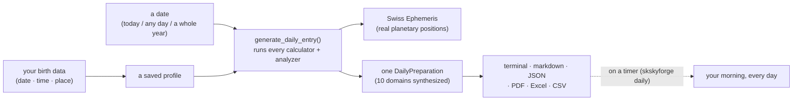
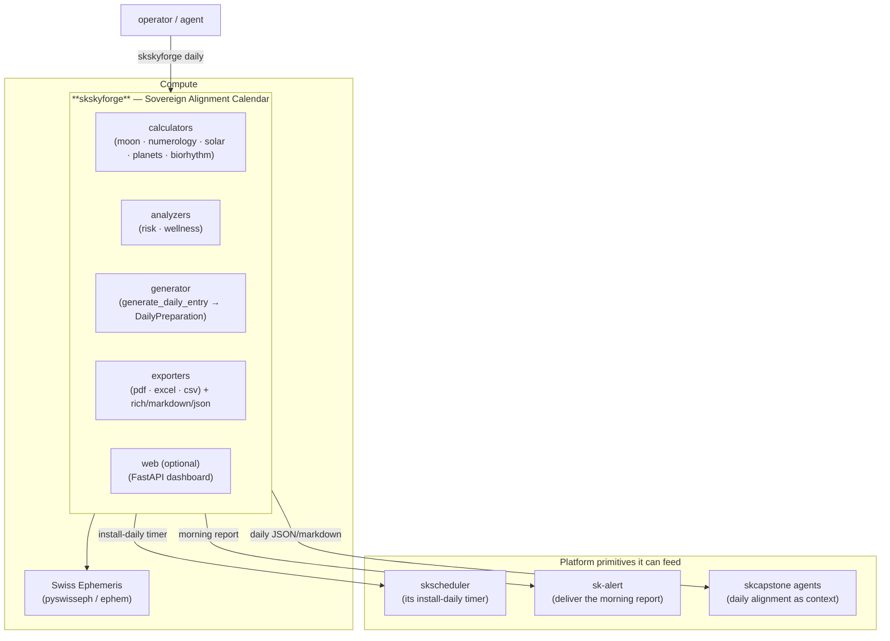

# skskyforge — SKyForge 🌟

> **Forge your sovereign path through the cosmos.** One command, ten domains of
> daily guidance, fused into a single morning report — on **your** hardware, for
> **your** birth data, no app, no account, no cloud.

skskyforge is the **Sovereign Alignment Calendar System** of the
[SKWorld](https://skworld.io) ecosystem. It takes a person's birth data and a date
and produces a complete **daily alignment report** — moon phase, numerology,
solar transits, Human Design, I Ching, biorhythm cycles, risk analysis, and
wellness practices — all computed locally from the **Swiss Ephemeris** (real
astronomy, not a lookup table) and rendered to your terminal, a file, PDF, Excel,
CSV, or JSON.

It is built to run **non-interactively on a timer**: `skskyforge daily` is designed
to fire every morning from a systemd timer or crontab and drop today's report where
an agent (or you) can read it.

## The 60-second version



Each domain is a small, self-contained calculator/analyzer; the generator
orchestrates all of them and synthesizes a daily theme, power hours, caution
periods, an affirmation, and a closing reflection.

## Quickstart

```bash
pip install -e ".[all]"                          # core + geocoding (geopy/timezonefinder)
skskyforge profile create \
  --name luna --birth-date 1992-06-21 \
  --birth-time 14:30 --birth-location "Austin, TX"   # auto-geocodes via OpenStreetMap
skskyforge preview --date 2026-03-20 --profile luna  # one rich day in your terminal
skskyforge daily --profile luna --format markdown    # today's report (non-interactive)
skskyforge generate --year 2026 --profile luna --format pdf   # a whole year as a PDF
skskyforge install-daily --time 07:30 --profile luna # schedule it (systemd/cron/schtasks)
```

Profiles, output, and settings live under `~/.skskyforge/`. The CLI entrypoint is
`skskyforge` (Python/Click); a thin `skskyforge-js` shim is published for npm
discoverability.

## The 10 domains

| # | Domain | What it computes | Source |
|---|--------|------------------|--------|
| 1 | 🌓 **Moon Phase & Sign** | lunar phase %, zodiac sign, element/modality, void-of-course windows | `calculators/moon.py` |
| 2 | 🔢 **Numerology** | life path, personal year/month/day, universal day, day theme | `calculators/numerology.py` |
| 3 | 🌞 **Solar Return** | sun sign, natal→transit house focus + theme, planetary aspects | `calculators/solar.py` + `planets.py` |
| 4 | 🧬 **Human Design** | type, strategy, authority, signature, not-self, daily gate activations | `generators/daily_entry.py` + `calculators/planets.py` |
| 5 | ☯️ **I Ching** | daily hexagram (from the Sun gate), trigrams, changing lines, guidance | `generators/daily_entry.py` |
| 6 | 📈 **Biorhythm** | physical / emotional / intellectual cycles + critical-day flags | `calculators/biorhythm.py` |
| 7 | ⚠️ **Risk Analysis** | multi-domain risk score (0–100) + warnings | `analyzers/risk.py` |
| 8 | 🧘 **Exercise & Embodiment** | element-tuned activity type, intensity, time, duration | `analyzers/wellness.py` |
| 9 | 🥣 **Nourishment** | element-based dietary guidance | `analyzers/wellness.py` |
| 10 | 📖 **Spiritual Reading** | curated wisdom text rotated by elemental energy (Stoic/Taoist/Buddhist/Sufi) | `generators/daily_entry.py` |

Everything is fused into a single `DailyPreparation` model (`models/daily_entry.py`)
that also carries the synthesized **daily theme**, **power hours**, **caution
periods**, **affirmation**, **mantra**, and **closing reflection**.

## Commands

| Command | What it does |
|---|---|
| `skskyforge daily` | today's full report — `--format text\|markdown\|json`, `--output stdout\|file` (built for timers) |
| `skskyforge preview --date YYYY-MM-DD` | one day, rendered richly in the terminal |
| `skskyforge generate --year YYYY [--month M]` | a full year (or single month) → `json` / `pdf` / `excel` / `csv` |
| `skskyforge install-daily [--time HH:MM]` | schedule the daily report (systemd timer → crontab fallback; `schtasks` on Windows) |
| `skskyforge uninstall-daily` | remove the scheduled report |
| `skskyforge profile create / list / show / delete` | manage birth-data profiles (geocoding via OpenStreetMap) |

## Where it lives in SKStack v2

skskyforge is a **Compute** capability — a self-contained generator/analyzer
pipeline that turns birth data + a date into a daily report. It owns no shared
infrastructure; its one ecosystem touch-point is the **scheduled `daily`
command**, which makes it a natural producer for the platform's scheduling and
alerting primitives and an agent-readable context source.



Per `SKILL.md`, the `daily` command is auto-discoverable by OpenClaw/skcapstone
agents: an agent can invoke `skskyforge daily --format json` to pull the current
day's alignment as context.

## Documentation

| Doc | Contents |
|---|---|
| **[Architecture](docs/ARCHITECTURE.md)** | the calculator → analyzer → generator → exporter flow, the scheduled-report path, source map, and where-it-lives (mermaids) |
| **[CLI Quickstart](docs/CLI_QUICKSTART.md)** | get a calendar in under 5 minutes |
| **[agent.md](agent.md)** | technical/agent specifications |

## Requirements & license

- Python 3.10+; Swiss Ephemeris data (handled via `pyswisseph` / `ephem`).
- Optional `[web]` extra adds a FastAPI dashboard; `[all]` adds geocoding + dev tools.
- Licensed **AGPL-3.0-or-later**, © smilinTux.

---

Part of the **[SKWorld](https://skworld.io)** sovereign ecosystem · *Scientifically
mapped. Spiritually grounded.* · 🐧 smilinTux — staycuriousANDkeepsmilin
