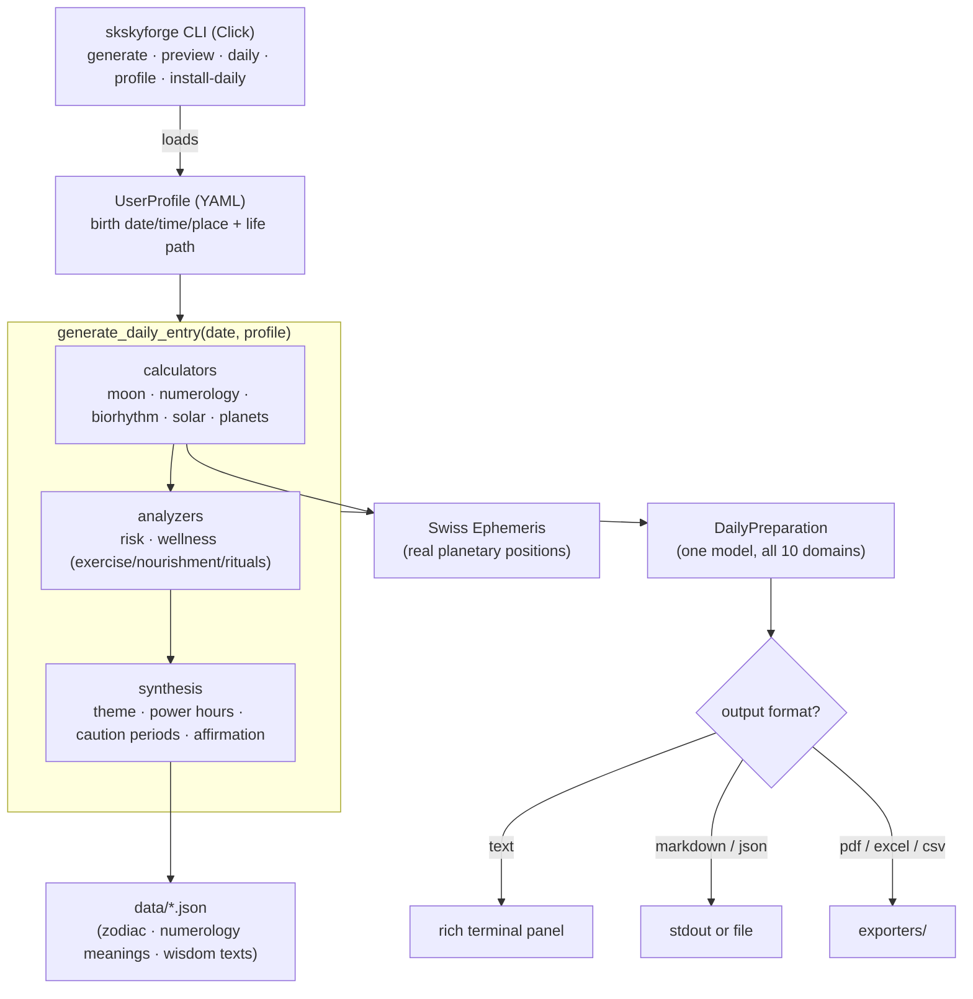
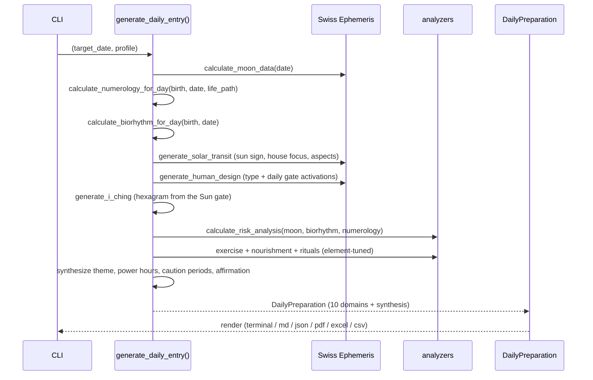
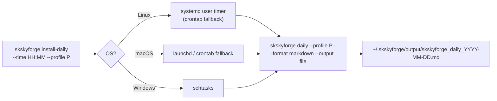
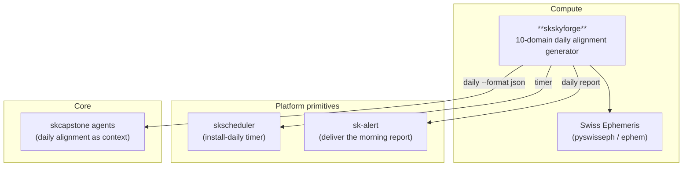

# skskyforge — Architecture

> How a birth date + a calendar date become a ten-domain daily alignment report,
> and where that report flows in the SKWorld stack.

skskyforge is a **pure generator pipeline**. It has no daemon, no database, and no
network dependency at compute time (geocoding aside, which happens once, at profile
creation). Everything is: *load a profile → run a set of calculators and analyzers
against a date → synthesize → render*. The astronomy is real — planetary positions
come from the **Swiss Ephemeris** (`pyswisseph` / `ephem`), not a lookup table.

---

## The big picture

The single output object is `DailyPreparation` (`models/daily_entry.py`). Every CLI
command — `preview`, `daily`, and each day of `generate` — produces one of these and
then chooses how to render it.

---

## The daily-entry flow (what `generate_daily_entry` actually does)

The orchestration lives in `generators/daily_entry.py`. The order matters: I Ching
is derived from the Human Design Sun gate, and the synthesis step reads several
upstream domains.

Notable couplings, grounded in the code:

- **I Ching ← Human Design.** The 64 HD gates map to the 64 I Ching hexagrams;
  `generate_i_ching` picks the hexagram from the active **Sun** gate.
- **Spiritual reading, exercise, nourishment, affirmation ← Moon element.** The
  moon sign's element (Fire/Earth/Air/Water) routes the wisdom tradition
  (Stoic/Taoist/Buddhist/Sufi), the element-tuned exercise, and the affirmation.
- **Risk analysis ← moon + biorhythm + numerology**, e.g. moon void-of-course and
  low intellectual biorhythm both feed caution periods.

---

## The scheduled-report path

`skskyforge daily` is deliberately non-interactive so a scheduler can run it every
morning. `install-daily` writes the schedule using whatever the OS supports best.

On Linux it prefers a **systemd user timer** (`skskyforge-daily.timer` +
`.service`) and falls back to a `crontab` line; on Windows it registers a
`SKSkyforgeDaily` task via `schtasks`. `uninstall-daily` reverses whichever was
installed.

---

## Source / content map

| Path | Role |
|---|---|
| `src/skskyforge/cli.py` | Click CLI — all commands, rich rendering, the systemd/cron/schtasks installer |
| `src/skskyforge/generators/daily_entry.py` | the orchestrator (`generate_daily_entry`) + HD/I-Ching/spiritual/synthesis logic |
| `src/skskyforge/calculators/moon.py` | lunar phase %, zodiac sign, element/modality, void-of-course |
| `src/skskyforge/calculators/numerology.py` | life path, personal year/month/day, universal day |
| `src/skskyforge/calculators/biorhythm.py` | physical / emotional / intellectual cycles + critical days |
| `src/skskyforge/calculators/solar.py` | sun sign + natal→transit house focus |
| `src/skskyforge/calculators/planets.py` | ephemeris planetary positions, aspects, HD gate activations |
| `src/skskyforge/analyzers/risk.py` | multi-domain risk score (0–100) + warnings |
| `src/skskyforge/analyzers/wellness.py` | exercise, nourishment, and ritual recommendations |
| `src/skskyforge/exporters/{pdf,excel,csv}_exporter.py` | PDF / Excel / CSV renderers |
| `src/skskyforge/models/daily_entry.py` | `DailyPreparation` — the unified output model |
| `src/skskyforge/models/domains.py` | per-domain pydantic models (Moon/Numerology/HD/I-Ching/…) |
| `src/skskyforge/models/profile.py`, `birth_data.py` | profile + birth-data models (load/save YAML) |
| `src/skskyforge/services/geocoding.py` | OpenStreetMap geocoding → lat/long + IANA timezone |
| `src/skskyforge/data/*.json` | reference data: `zodiac_signs.json`, `numerology_meanings.json`, `spiritual_library/wisdom_texts.json` |
| `src/skskyforge/web/` | optional FastAPI dashboard (`[web]` extra) |
| `config/settings.yaml` | global generation/export/calculation toggles |

---

## Where it lives in the ecosystem

skskyforge is a **Compute** capability: a stateless generator that depends only on
the Swiss Ephemeris and its bundled reference data. It produces a daily report; the
platform's scheduling, alerting, and agent layers consume it.

The contract with the rest of SKWorld is intentionally thin: one well-defined,
machine-readable command (`skskyforge daily --format json`) that any agent or
scheduler can call. Per `SKILL.md`, that makes the day's alignment available to
OpenClaw/skcapstone agents as context for the morning.

---

Part of the **[SKWorld](https://skworld.io)** sovereign ecosystem · 🐧 smilinTux
